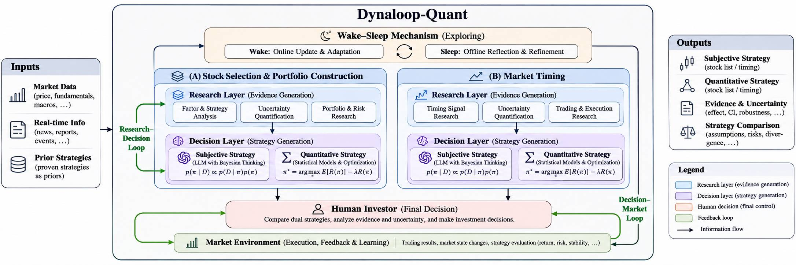

# DynaLoop-Quant

一个可复现的量化因子研究工程：从本地标准特征中学出因子，用预注册的统计流程给出证据，再把证据接到选股组合、择时与模拟撮合。主观侧接入大模型与每日补库的活策略库，最终裁定权留给人。项目追求研究方法的可信与工程闭环的完整，**不宣称收益、可交易性或未来持续有效**。

当前主线与交付物是**学得的有效因子本身**，不是研究报告，也不是盈利承诺：本地仿 Qlib 的 Alpha158 标准特征 → 轻量梯度提升模型 → 模型预测即因子，再经双通道认证给出统计证据。历史神经实验与手写公式模板等旧路线仅作对照，不代表当前研究能力。

## 一眼看现状

- **学得因子**：一个冻结的历史样本外轮次，58 期横截面认证，族级检验后判为「横截面有效因子」；结论只对冻结时的实现版本与模型成立，后续实现修正须另开新轮次，不复用已查看窗口。
- **双通道并列**：横截面选股与时序择时各自独立认证、各有中文标签，不混进同一判定族、不共用错误率、不互相外推。择时通道一个完整预注册轮次如实给出否定结论（全族证伪），未调规则凑肯定结论。
- **滚动验证**：五折独立重训的 expanding-window 样本外检验，如实呈现排序信息系数逐折衰减与多折证据不足；这是对稳健性的检验，不是「稳定有效」的宣称。
- **终局骨架**：先选股（组合）再在选中标的择时，每块「研究」与「执行」类型强制分离；统计证据决定何时更新。已用真实归档数据跑通端到端，产物全部标注不构成新的有效性结论。
- **主观侧**：活策略库（每日采集 → 索引检索 → 主观参考 → 模拟撮合 → 经验星级回流）、新闻舆情公共数据层、大模型主观分析、人类最终裁定与双策略对比。主观输出仅是参考，不进判定层。

## 架构

目标蓝图如下（原图）。它描述的是终局设计：左侧三类输入汇入研究—决策回路，中部「选股与组合」和「市场择时」两路并行，各自的研究层产出证据、决策层生成主观与量化策略，最终交由人类裁定；下方的市场环境承接执行、反馈与学习，右侧是四类输出。当前实现进度见本节末尾的落地状态。



源码位于 `src/dynaloop/`，12 个顶层包严格对应 [ARCHITECTURE.md](ARCHITECTURE.md)：

| # | 模块 | 职责 |
|---|---|---|
| 01 | Interaction | 交互接口与前端可视化 |
| 02 | Orchestrator | 多阶段闭环编排与两阶段串联 |
| 03 | Infrastructure | 配置、日志、调度、存储等工程基础 |
| 04 | Market Environment | 不可变环境定义与运行载体 |
| 05 | Data | 数据源注册、数据集、快照、血缘与质量 |
| 06 | Model | 因子候选生成与可替换生成器 |
| 07 | Training Engine | 奖励计算与策略更新 |
| 08 | Inference Engine | 冻结策略下的可复现采样 |
| 09 | Research Engine | 因子表示、认证、审计与诊断 |
| 10 | Validation & Backtesting | 事件驱动回测、撮合、成本与回放 |
| 11 | Statistical & Uncertainty | 族级检验、区块重采样与不确定性 |
| 12 | Experiment Management | 实验定义、配置快照与留痕 |

模块内部高度解耦、职责单一、可独立替换；模块之间作为服务整体通过包级公开接口直接拼接，不复制逻辑、不另建平行适配层。工程约定见 `AGENTS.md`，系统契约见 [docs/system_contract.md](docs/system_contract.md)。

在此骨架之上，目标蓝图的四块输出——主观策略、量化策略、证据与不确定性、策略对比——均已上屏；人类最终裁定与策略对比输出已落地。市场反馈闭环中「经验回流」已实现，统计更新闸门已实装但尚未接入这条真实反馈流；醒睡机制（Wake-Sleep）代码与实验全保留，按既定方向暂缓、非放弃。

## 核心能力

### 学得因子与统计认证
- 本地仿 Qlib 特征库与模型：158 项 Alpha158 标准特征、轻量梯度提升模型、可替换的数据层与处理器，逐层可改、不依赖 Qlib 专有二进制格式。权威流程见 [docs/learned_factor_workflow.md](docs/learned_factor_workflow.md)。
- 双通道认证：横截面选股（零假设为无相对排序能力，功效靠宽度）与时序择时（零假设为不胜过零预测与历史均值，功效靠时间长度）。三支柱为因果隔离、抗数据窥探的族级检验、跨期稳定性与留一法。终态为有效 / 证据不足 / 被证伪。门槛逐项登记上游依据，见 [docs/factor_evaluation_baseline.md](docs/factor_evaluation_baseline.md)。
- 因果隔离采用历史样本外预注册：搜索期结束后一次性冻结族与全部参数、先落指纹，再用冻结日之后的历史数据一次性验证；窗口一经查看即消耗，再搜索须开新族、用新区间并登记前序轮次。
- 滚动样本外验证：折定义先冻结再逐折运行，跨折不合并错误率，缺失如实留空。
- 附加诊断（折价夏普、过拟合概率、残差信息系数、秩自相关、半衰期、中性化、试验台账等）严格只报告，不进判定层。

### 终局两阶段系统
选股研究与执行、择时研究与执行由类型强制分离；冻结规则才能进入执行阶段，改规则须重开研究轮次。选股权重支持等权 / 分数加权 / 反波动率加 Top-K  dropout；择时阈值由成本推出、经 purged walk-forward 学与稳定性筛选；更新闸门用配对区块自助的证据决定何时晋升。已用真实归档数据端到端跑通，一切产物标注「无新有效性声明」。详见 [docs/factor_system_redesign_status.md](docs/factor_system_redesign_status.md)。

### 数据与回测
- 数据管理：数据源分本地与 API 两层，数据集为其子层；保存源即探样本、识别布局、推断列语义与参数绑定、缓存能力声明，新增数据源无需改 Python 或重启。源有的列一律展示，源没有的不生成、不解释；数据变更发新版本，删除走软删。契约见 [docs/data_ui_contract.md](docs/data_ui_contract.md)。
- 回测引擎：核心只收有序 bar records，窗口是调用参数并写进规格，不解释时间单位；成交时点、价格源、订单顺序、佣金滑点等撮合语义显式进配置，时点正确性由引擎强制。策略逻辑是代码对象，配置只选类与参数。产出逐笔账本、每 bar 权益与描述性指标，成本与换手、毛净并列。
- 回放面板：按源声明为每个数值列生成面板，指标直接调用成熟的 `ta` 库计算，多面板共享时间轴与播放头；OHLC 蜡烛按涨红跌绿绘制。

### 主观侧与公共数据
- 活策略库：采集时即可用时间恒等于采集时间，禁止用发布日期回填造成前视；检索按可用时间硬门控，结合标签与关键词，按经验星级（半衰期衰减的保守下界）排序。星级是信念参考，不是显著性。
- 主观分析：聚合新闻舆情、情绪周期、策略检索等输入，经大模型生成参考文本；输出被明确标注为「不是因子、不是结论、不是投资建议」。成本上默认选积分倍率最低的可用模型，不假设任何模型免费。
- 公共数据层与审计：新闻舆情、A 股情绪周期为可选真实源，失败显式标记不可用；QBX 风格审计检查时间可用性、合约可见的前视与身份一致性，只保审计性质、不增加市场信息。

### 交互与可见化
前端为单页应用，覆盖总览、研究、证据、主观、决策、数据、回测、实验、闭环、运行时、设置等页面。**全站中英文一键切换，默认中文**，界面文案与数据展示分开处理。证据页只读投影冻结轮次与滚动验证结果，缺失显示为空、绝不编造。

## 统计纪律与边界

这些是硬约束，改进工程不越过它们：

- 新增指标与门槛必须先登记上游依据；纯报告字段不改变冻结指纹。
- 已查看的验证窗口一次性消耗；不为凑肯定结论改族、换窗、调参或放松族级 / 稳定性 / 期数门槛；族级不显著、全族证伪、证据不足都是合法结论。
- 不宣称跨轮序贯错误率、共形覆盖、盈利、因果或未来持续；单轮有效不等于稳定产出，稳定产出仅指流程可重复执行。
- 中性化、去极值、商业级时点成分股、容量扫描、真实撮合约束、前向跟踪等尚未补齐；幸存者偏差未消除，已如实标注。
- 主观输出与情绪分数仅作参考，不进判定层；「模拟撮合」不等于实盘。

设计与沿革见 [docs/CORE_DESIGN.md](docs/CORE_DESIGN.md)、[docs/research_process.md](docs/research_process.md)、[docs/brain.md](docs/brain.md)，平台审计见 [docs/platform_audit_2026-11-11.md](docs/platform_audit_2026-11-11.md)。

## 快速开始

需要 Python 3.11 或更高版本；Conda 仅用于环境隔离，非必需。前端需要 Node.js。

```powershell
# 安装后端（可编辑模式）
python -m pip install -e .

# 启动接口服务
python -m uvicorn dynaloop.interaction.api:create_app --factory --host 127.0.0.1 --port 8000

# 另开一个终端启动前端
cd frontend
npm install
npm run dev
```

前端默认连本地 8000 端口，可用 `DYNALOOP_API_TARGET` 改写代理目标。运行态数据默认落在用户目录 `~/.dynaloop`，可用 `DYNALOOP_STATE_DIRECTORY` 指定独立目录；不要用测试态目录作日常用途。主观大模型接口的发布密钥与端点可用 `DYNALOOP_LLM_PUBLISHABLE_KEY` 与 `DYNALOOP_LLM_ENDPOINT` 覆盖，默认值为绑定来源域名的公开值、不是长期私密密钥。

发布范围说明：本公开仓库只含源码、文档与配置。**实验产物、原始数据、模型检查点与测试套件不随仓库发布**；认证结果按文档中的预注册流程在本地数据上复现，开发期的完整回归（后端 842 项 + 320 子测试、前端 69 项）作为内部验收记录，不代表公开仓库自带这些数据。

## 文档索引

- [架构总览](ARCHITECTURE.md) · [系统契约](docs/system_contract.md) · [核心设计](docs/CORE_DESIGN.md)
- [因子研究流程](docs/research_process.md) · [评估基线](docs/factor_evaluation_baseline.md) · [有效因子](docs/effective_factor.md) · [横截面因子](docs/cross_section_factor.md)
- [学得因子流程](docs/learned_factor_workflow.md) · [因子系统重设计状态](docs/factor_system_redesign_status.md) · [神经大脑](docs/brain.md)
- [数据界面契约](docs/data_ui_contract.md) · [参考实现](docs/reference_implementations.md) · [相关工作](docs/RELATED_WORK.md)

## 许可

Apache License 2.0，详见 [LICENSE](LICENSE)。
